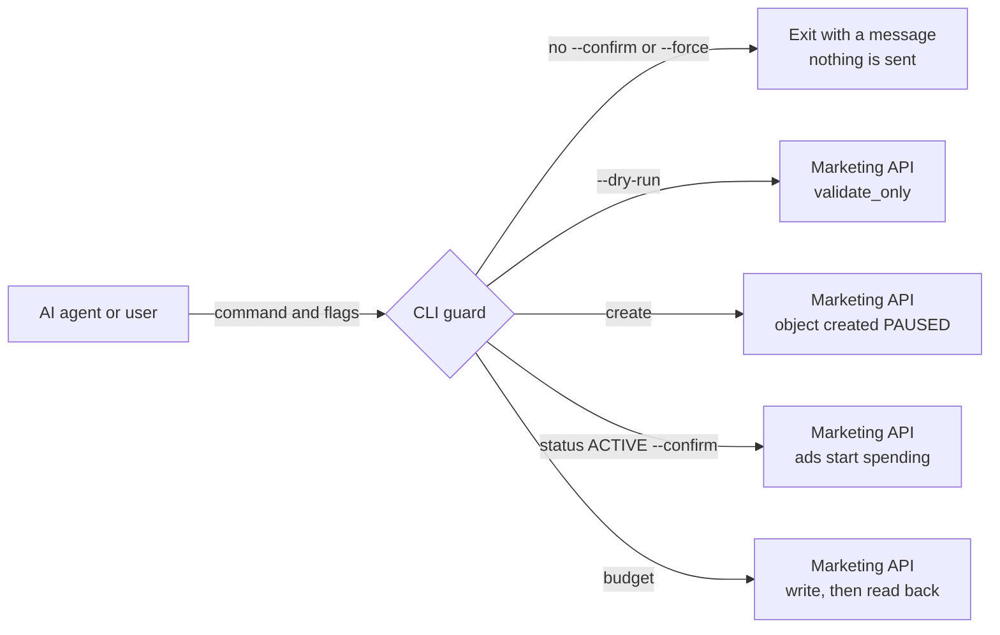

# Meta Ads automation

[](https://github.com/ahrimmedia-beep/meta-ads-automation/actions/workflows/ci.yml)

A Python command line tool that manages a Meta ad account through the Marketing API, so an AI agent or a script can build and check campaigns. Everything it creates starts paused. Turning ads on needs an explicit `--confirm` flag, and create commands accept `--dry-run`. A second script publishes Instagram Reels through the Graph API.

## The problem

An AI agent or a script with an ads token can spend real money by mistake. One wrong call can turn on an ad, delete a campaign or raise a budget. A large budget change also sends an ad set back into Meta's learning phase, so even an edit that looks small has a cost. The agent needs limits that the tool itself enforces.

## What I built

- A command line tool on the Python standard library for the whole campaign cycle: campaigns, ad sets, video ads, audiences, A/B tests, insights reports and an account audit.
- Safety rules inside the tool:
  - every campaign, ad set and ad is created paused;
  - turning ads on and deleting need `--confirm`, otherwise no request is sent;
  - `--dry-run` sends the request with `validate_only`, so Meta checks it and creates nothing. Where Meta has no such check, the dry run only prints the request;
  - a daily budget change over 20% needs `--force`, and the new budget is read back after the write.
- Meta errors shown as one line with the title, message, code and subcode. The access token is masked if Meta quotes it back.
- A Reels publisher. It creates a media container, uploads the video, waits until Meta finishes processing it, and publishes only as a separate step.

## How it works



The guard runs before any request. A refused command exits with a message and sends nothing to Meta. The message tells the agent to come back with `--confirm` only after the account owner says yes. A dry run reaches Meta, which checks the request and creates nothing. Everything else is created paused, so a new ad does not spend money until it is turned on with `status ACTIVE --confirm` or by hand in Ads Manager.

The Reels flow has two commands. `prepare` uploads the video into a container and checks its status every 10 seconds, up to 60 times. `publish` takes the container id and makes the Reel public.

## Selected code

This repository holds the safety layer and a few real parts of the tool, with tests, to show how the code is written. The full command set, targeting presets, creative texts and the launch playbooks stay private.

| File | What it shows |
|---|---|
| [`meta_ads/graph.py`](meta_ads/graph.py) | Graph API client on the standard library: JSON params, multipart upload, paging, and Meta errors turned into one readable line. The HTTP call is injected, so tests need no network. |
| [`meta_ads/commands.py`](meta_ads/commands.py) | The safety rules: paused by default, `--dry-run` through `validate_only`, `--confirm` to turn ads on or delete, `--force` and a read back check for budget changes over 20%. |
| [`meta_ads/cli.py`](meta_ads/cli.py) | Argument parsing for these four commands and credentials from `.env`. |
| [`meta_ads/reels.py`](meta_ads/reels.py) | Instagram Reels: container, upload, status polling, and publish as a separate step. The HTTP call and the pause between checks are injected. |
| [`tests/`](tests/) | Tests with a fake HTTP layer that records every request. |

```bash
python -m venv .venv && source .venv/bin/activate
pip install pytest
pytest                     # 54 tests, Python 3.11+
python -m meta_ads --help
```

## Stack

Python 3.11+ standard library (urllib, argparse, json), Meta Marketing API, Instagram Graph API, pytest, ruff, GitHub Actions.

## My role

I built the tool alone: design, the API client, the safety rules, the commands and the Reels publisher.

## License

Published for viewing only. All rights reserved, see [LICENSE](LICENSE).
